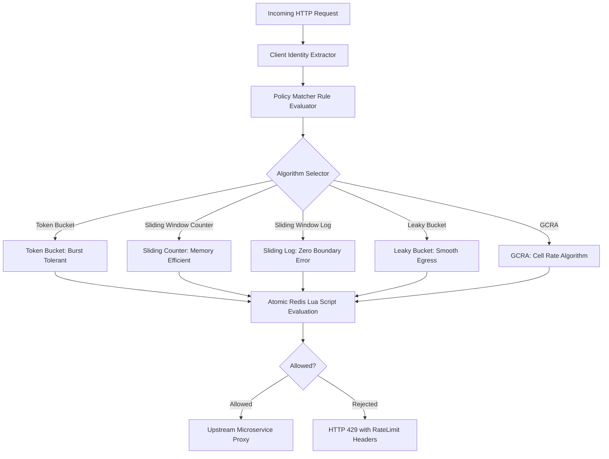
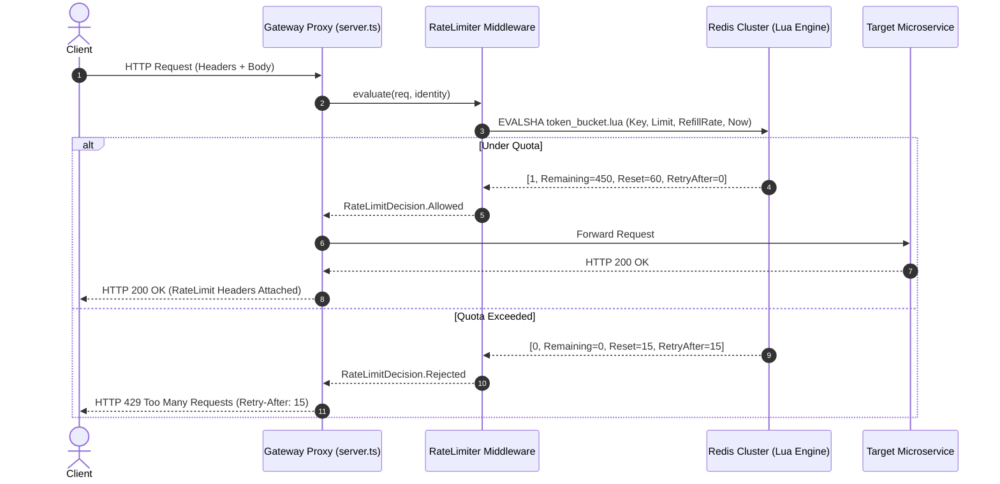
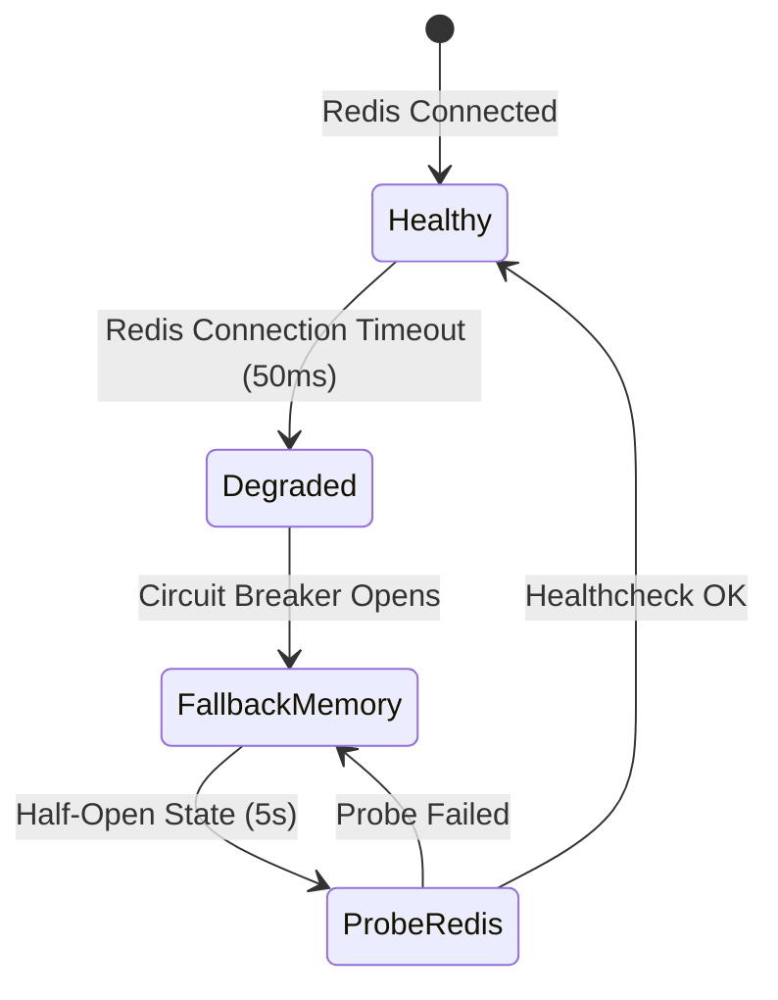

# F1: Multi-Algorithm Rate Limiting Engine

## Overview & Architecture
The multi-algorithm rate limiting engine in `src/algorithms/` and `packages/core/` provides mathematically rigorous implementations of five foundational traffic regulation algorithms: Token Bucket, Leaky Bucket, Fixed Window, Sliding Window Log, and Sliding Window Counter.

## Request Flow Sequence Diagram

## Failure Mode & Degradation Path

## Say It Out Loud
> "I built the multi-algorithm rate limiting engine in `src/algorithms/` to regulate API traffic according to specific tenant contracts and endpoint workloads. Different APIs require fundamentally different traffic shapers: background bulk exports require Leaky Bucket for smooth steady-state drain; bursty web endpoints use Token Bucket to tolerate traffic surges; and expensive search queries use Sliding Window Counter to strictly prevent boundary-burst attacks.
> 
> When a request arrives at `apps/gateway/src/server.ts`, my middleware resolves the client's identity, queries the matching policy in `src/policy/rule.ts`, and executes an atomic Lua script in Redis. A single atomic operation calculates current token replenishment, decrements the bucket, updates the timestamp, and returns whether the request is allowed.
> 
> I chose to implement multiple specialized algorithms rather than forcing a single one-size-fits-all approach because burst-tolerant endpoints like search require different statistical guarantees than steady-rate payment processors.
> 
> If Redis becomes unresponsive or partitions, our storage layer circuit breaker trips within 50 milliseconds and transitions smoothly to an in-memory fallback store without dropping traffic.
> 
> One trade-off is that high-precision Sliding Window Log stores individual timestamps in a sorted set, which consumes significantly more memory than Sliding Window Counter, so we enforce memory limits on log-based policies."
