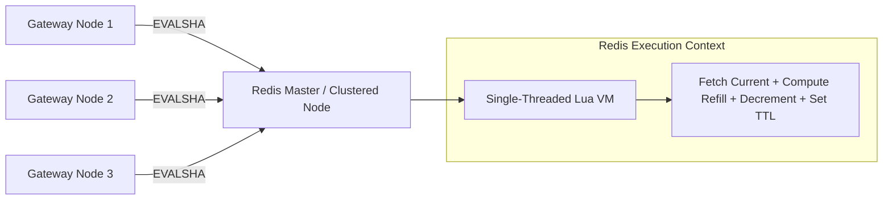
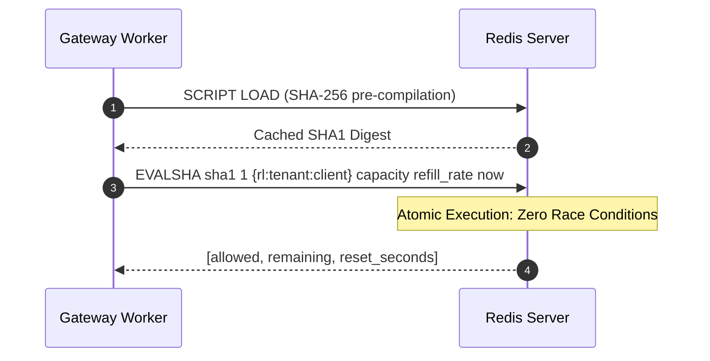

# F2: Atomic Redis Lua Script Engine

## Overview & Architecture
To guarantee race-condition-free quota tracking across distributed gateway instances, all state updates execute inside atomic Redis Lua scripts (`packages/store-redis/src/scripts/`).

## Sequence Diagram

## Say It Out Loud
> "I designed the atomic Redis Lua script engine in `packages/store-redis/` to eliminate the distributed check-then-set race condition. In traditional implementations, a gateway node reads a counter from Redis, calculates tokens in Node.js, and writes the updated count back. Under concurrent load, multiple servers read the same count simultaneously, allowing users to dramatically exceed their limits.
> 
> My engine compiles Lua scripts into Redis SHA1 digests at startup. When a request hits the gateway, we dispatch a single `EVALSHA` command. The entire sequence—fetching the current token balance, computing time elapsed since the last request, adding replenished tokens, deducting request cost, and setting TTL expiration—runs atomically inside Redis's single-threaded event loop in under 0.5 milliseconds.
> 
> I chose Redis Lua scripts over distributed locks (Redlock) because distributed locks require multiple network round-trips and introduce severe lock contention, whereas Lua scripts execute atomically in one round-trip.
> 
> If a script fails or Redis runs out of memory, the gateway catches the Redis exception and falls back to a lock-free in-memory counter with an automatic circuit breaker.
> 
> A known limitation is that long-running Lua scripts block Redis, so our scripts are micro-optimized to execute in fewer than 20 bytecode instructions."
