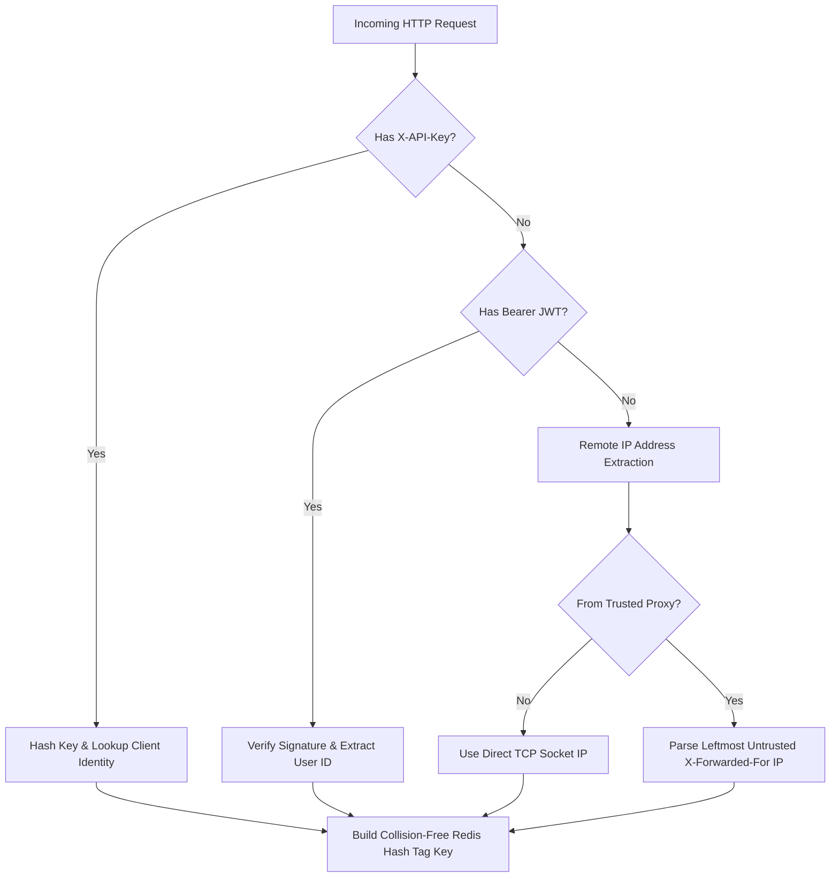

# F3: Multi-Dimensional Client Identity & Scopes

## Overview & Architecture
In `src/identity/` and `internal/identity/`, client requests are classified across multiple hierarchical dimensions: API Key, Authenticated User ID, Client ID, Route Pattern, Tenant ID, and Remote IP with trusted proxy CIDR validation.

## Say It Out Loud
> "I built the identity resolution pipeline in `src/identity/` to accurately identify clients regardless of how they access the API. In enterprise environments, traffic arrives from internal microservices, authenticated users, mobile clients, and unauthenticated public crawlers.
> 
> My pipeline inspects incoming HTTP headers using a prioritized fallback chain: it checks `X-API-Key` first, then inspects JWT authorization headers, and finally falls back to client IP. For IP resolution, it validates upstream load balancers against a configured trusted CIDR list, safely extracting the client's real IP from `X-Forwarded-For` without spoofing vulnerabilities.
> 
> It then formats a collision-free Redis key formatted with Redis Cluster hash tags, like `{tenant_acme:client_42}:route_checkout`, ensuring that all rate limits for a given client hash to the same cluster slot.
> 
> I chose this multi-tiered resolution model because security cannot rely purely on unauthenticated IP addresses, which change behind mobile cellular towers and NAT gateways.
> 
> If an API key is malformed or invalid, the pipeline immediately rejects the call with an HTTP 401 Unauthorized before any rate limit counters are evaluated."
