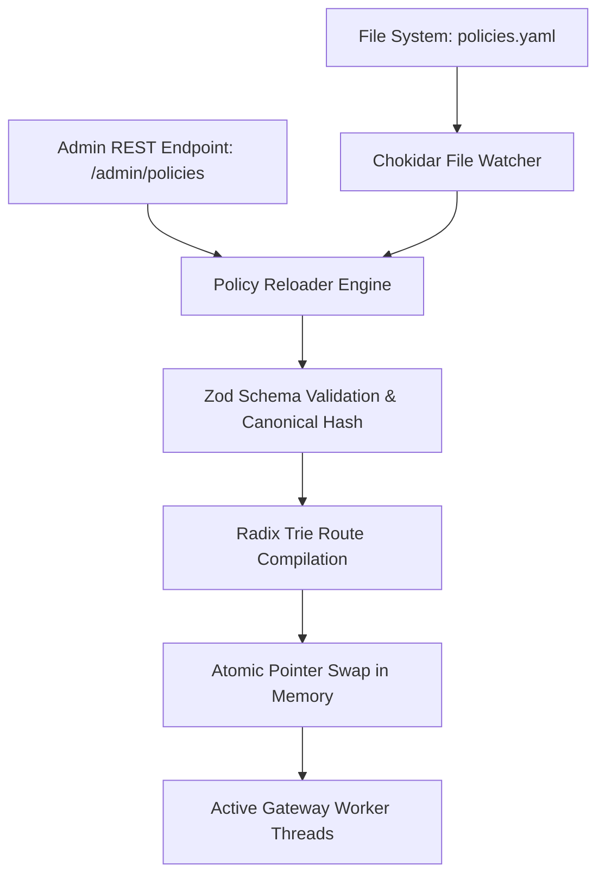

# F4: Dynamic Policy Matcher & Hot-Reload Engine

## Overview & Architecture
The policy matching engine in `src/policy/` and `internal/policy/` maps incoming HTTP routes and client tags to rate limit rules, supporting atomic hot-reloading without service restarts.

## Say It Out Loud
> "I implemented the policy matching and hot-reload engine in `src/policy/` to allow DevOps teams to adjust rate limits and block abusive tenants in production with zero downtime.
> 
> The engine parses declarative policy configurations written in YAML or submitted via our administrative REST API. It uses a high-performance Radix Trie to match URL paths like `/api/v1/users/:id/profile` in sub-microsecond time, supporting weighted route costs and tenant inheritance.
> 
> Using `chokidar` and atomic memory pointers, the engine watches configuration files on disk. When a change is detected, it validates the schema using Zod, builds the new Radix Trie in memory, and swaps the pointer atomically. Ongoing requests finish using the old policy while new requests immediately use the updated limits.
> 
> I chose an atomic in-memory pointer swap over polling a database because routing decisions happen on the hot path of every single request and cannot incur external query latency.
> 
> If an operator submits a malformed YAML bundle with invalid syntax or overlapping priorities, the validator rejects it immediately, keeping the existing valid configuration intact."
