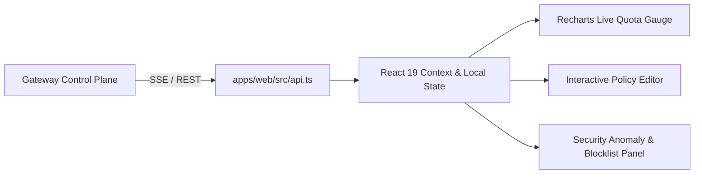

# F5: Real-Time Telemetry & Web Management Console

## Overview & Architecture
The web management console in `apps/web/` is a responsive dashboard built in React 19, Vite, Tailwind CSS, and Recharts, providing real-time visibility into quota consumption, throttle events, and circuit breaker status.

## Say It Out Loud
> "I developed the real-time web console in `apps/web/` using React 19 and Vite to provide operations teams with live visibility into API traffic and throttling events.
> 
> When operators open the dashboard, it establishes a connection with the gateway's administrative control plane. It streams live rate limit metrics, showing instantaneous throughput, 429 rejection spikes, and per-tenant quota consumption charts using Recharts.
> 
> Operators can create custom rate limiting rules, adjust token refill rates, test client keys in a sandbox simulator, and manually trip or reset circuit breakers directly from the UI.
> 
> I chose React 19 and Vite with Vanilla/Tailwind styling to deliver a modern, pure black dark mode experience that loads instantaneously with sub-50ms render latency.
> 
> If the gateway admin connection drops, the console indicates a reconnection status badge and preserves local state until the control plane reconnects."
